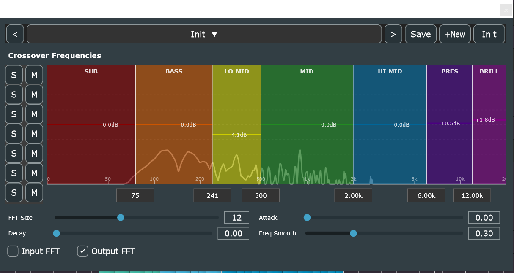

# phu-splitter

JUCE-based **VST3 audio effect** that splits a stereo input into **7 frequency bands** using Linkwitz-Riley crossover filters.

Each band is output as a separate stereo channel, enabling multiband processing workflows in a DAW.



## Features

- **7-band Linkwitz-Riley crossover** with 48 dB/octave slopes
- **Draggable crossover frequency bar** — click and drag dividers on a logarithmic frequency axis
- **Draggable amplify/attenuator bar** — click and drag horizontal line in each band to amplify/attenuate it's output
- **Editable frequency text boxes** — double-click to type a value in Hz, kHz, or **musical note names** (e.g. `C#3`, `E#1`, `Ab4`)
- **Preset system** — save, load, rename, and delete presets; navigate with prev/next buttons
- **Full DAW automation** — crossover frequencies are exposed as automatable parameters
- **State save/restore** — all settings are persisted with the DAW session

## Releases

Release zips for Windows (x64, ARM64), Linux (x64) and macOS (arm64, x64) are built by CI and published on the GitHub Releases page whenever a `v*` tag is pushed or the release workflow is run manually with a tag. See [docs/RELEASE.md](docs/RELEASE.md) and [CONTRIBUTING.md](CONTRIBUTING.md#ci--releases).

## Installation (Windows)

> **Prerequisite:** The plugin requires the **Microsoft Visual C++ 2015–2022 Redistributable (x64)** to be installed on the host machine.
> Download: [vc_redist.x64.exe](https://aka.ms/vs/17/release/vc_redist.x64.exe) — already present if Visual Studio 2019 or 2022 is installed.

## Build (CMake + Visual Studio)

This repo is set up for CMake presets.

### Windows

**Recommended (PowerShell):**
```powershell
.\scripts\build.ps1           # Build Release configuration
.\scripts\build.ps1 -Clean    # Clean build
.\scripts\build.ps1 -Config Debug  # Build Debug configuration
```

The build script automatically locates cmake.exe in Visual Studio installations.

**Manual CMake:**
- Configure: `cmake --preset windows-x64-vst3-release`
- Build: `cmake --build --preset windows-x64-vst3-release-build`
- Debug: `cmake --preset windows-x64-vst3-debug` then `cmake --build --preset windows-x64-vst3-debug-build`

### Linux

See [docs/LINUX_BUILD.md](docs/LINUX_BUILD.md) for detailed instructions.

Quick start:
```bash
sudo bash scripts/install-linux-deps.sh  # Install dependencies
cmake --preset linux-x64-vst3-release         # Configure
cmake --build --preset linux-x64-vst3-release-build   # Build
```

### macOS

```bash
cmake --preset macos-arm64-release           # Configure (use macos-x64-release on Intel)
cmake --build --preset macos-arm64-release-build   # Builds VST3 and AU
```

Run `cmake --list-presets=all` to see all available presets.

JUCE (8.0.15) and phu-audio-lib are fetched automatically by CMake during the first configure (no submodules; network access required). CMake 3.28 or newer is required.

The targets built by the presets are `phu-splitter_VST3` (and `phu-splitter_AU` on macOS).

### Intel® MKL-accelerated FFT

`USE_INTEL_MKL` is `ON` by default. At configure time CMake looks for Intel® MKL in this order: the `MKLROOT` CMake variable, the `MKLROOT` environment variable, then (Windows) the local NuGet cache (package `intelmkl.static.win-x64`). `MKLROOT` should point to either the oneAPI MKL root (`.../mkl/latest`) or the NuGet native root (`.../intelmkl.static.win-x64/<version>/build/native`).

- **Found:** the plugin is compiled with `JUCE_DSP_USE_INTEL_MKL=1` and linked statically against MKL (sequential, no OpenMP runtime). The release builds for Windows x64 are built this way.
- **Not found:** CMake prints a status message and falls back to JUCE's built-in FFT. The plugin behaves identically.
- **Disable explicitly:** pass `-DUSE_INTEL_MKL=OFF`.

Intel® MKL has no ARM64 binaries, so Windows ARM64 builds always use the JUCE FFT. The Linux release builds also use the JUCE FFT; to use MKL on Linux, install oneAPI MKL (static libraries under `$MKLROOT/lib/intel64`) and set `MKLROOT` before configuring.

## Audio Processing

The plugin uses **Linkwitz-Riley crossover filters** to split the incoming stereo audio into 7 frequency bands:

| Band | Range | Colour |
|------|-------|--------|
| Sub bass | < 80 Hz | Dark red |
| Bass | 80 – 250 Hz | Burnt orange |
| Low-mid | 250 – 500 Hz | Yellow |
| Mid | 500 – 2000 Hz | Forest green |
| Upper-mid | 2000 – 6000 Hz | Steel blue |
| Presence | 6000 – 12000 Hz | Indigo |
| Brilliance | > 12000 Hz | Purple |

Each band is output to a separate stereo bus, allowing independent processing in your DAW.

### Default Crossover Frequencies

| Split | Frequency |
|-------|-----------|
| Sub bass / Bass | 80 Hz |
| Bass / Low-mid | 250 Hz |
| Low-mid / Mid | 500 Hz |
| Mid / Upper-mid | 2000 Hz |
| Upper-mid / Presence | 6000 Hz |
| Presence / Brilliance | 12000 Hz |

All crossover frequencies are adjustable via the UI or DAW automation.

### Note Name Input

Crossover frequencies can be entered as musical note names using equal-temperament tuning (A4 = 440 Hz):

- `A4` → 440 Hz
- `C#3` → 138.59 Hz
- `E#1` → 43.65 Hz (enharmonic of F1)
- `Db3` → 138.59 Hz (enharmonic of C#3)

Sharps (`#`, `##`), flats (`b`, `bb`), and octaves 0–9 are supported.

## Preset System

Presets are stored as XML files in `%APPDATA%/PhuSplitter/Presets/`.

- **Init** — built-in default preset (cannot be deleted or overwritten)
- **Save / Save As** — save current crossover frequencies to a named preset
- **Delete / Rename** — manage saved presets from the dropdown menu
- **Prev / Next** — step through presets sequentially

For a detailed code map see [CONTRIBUTING.md](CONTRIBUTING.md).
